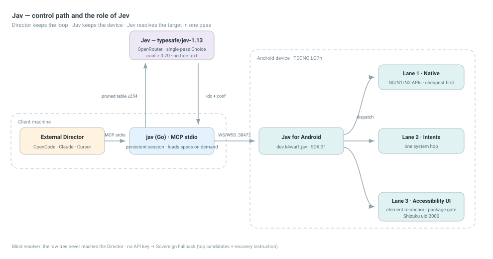
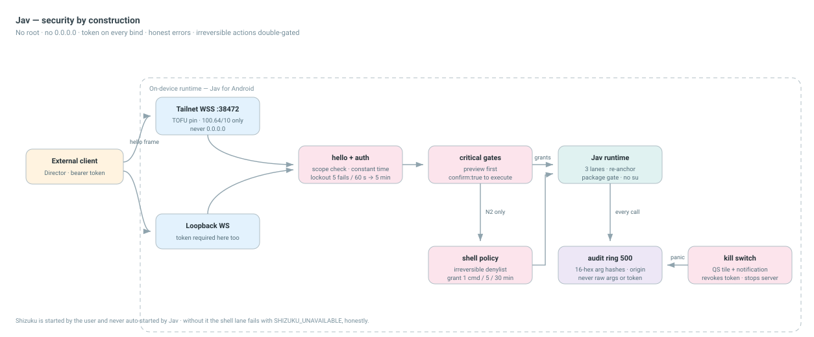

<div align="center">


# Jav

**Full-control Android MCP runtime. No root.**

Accessibility-first on-device app + Go MCP server (stdio): 38 atomic tools,
Shizuku-gated shell, WSS/Tailnet with TOFU pinning.

[](https://github.com/k4wai1/jav/releases)
[](#tools--38-in-4-groups)
[](#quickstart)
[](#what-is-jav)
[](#quickstart)
[](LICENSE)

[Releases](https://github.com/k4wai1/jav/releases) ·
[Protocol](docs/PROTOCOL.md) ·
[Benchmarks](docs/benchmarks/PERFORMANCE.md) ·
[Plan](PLAN.md)

</div>

> **English first, español después.** Normative detail lives in `AGENTS.md`,
> `PROTOCOL.md`, `ARCHITECTURE.md`, `PLAN.md` and `docs/specs/`.

---

## What is Jav

**Jav is a full-control Android MCP runtime without root.** An on-device app
(**Jav**, `dev.k4wai1.jav`) exposes the screen via `AccessibilityService` and
privileged actions via **Shizuku** (started by the user) to a Go MCP server on
the PC (`jav`, stdio).

| | **Jav** (this repo) | **Director** (external, not part of Jav) |
|---|---|---|
| What | Go MCP server (`cmd/jav`) + Android app `dev.k4wai1.jav` | OpenCode / Claude / Cursor / operator |
| Does | exposes 38 atomic MCP tools, runs no loops and no internal planner | reads each screen, picks one atomic tool per step, verifies the effect |
| Tactical help | serves `resolve_element` (blind S1 Jev resolver) | decides goals, gates, and approves previews |

Jav never loops, never plans and never invents coordinates. The Director holds
the loop; Jav holds the device.

## Architecture

<p align="center">
  <a href="docs/diagrams/jav-architecture.html"></a>
</p>

<p align="center"><sub>Interactive version: <a href="docs/diagrams/jav-architecture.html">docs/diagrams/jav-architecture.html</a></sub></p>

## How the flow works with Jev — recommended: OpenRouter

The Director reads the screen, picks one atomic tool per step and verifies the
effect. When the screen is noisy, `resolve_element` adds a blind tactical
resolver (S1 **Jev**): the accessibility tree is pruned to a numbered table
(≤254 candidates) and Jev answers in a single pass — a `Choice` + confidence,
**no free text**, anti-prompt-injection by construction. `conf ≥ 0.70` (tau) or
the **Sovereign Fallback** (top candidates + recovery instruction; the Director
decides). Measured on a real TECNO: **~3 s and ~$0.00005 per resolution**.

Recommended setup: an **OpenRouter** key. `jav pair` asks for it (optional), or
put `openrouter_api_key` in `~/.config/jav/config.json`, or export
`OPENROUTER_API_KEY`. Default model `typesafe/jev-1.13`; an optional S2 model
(`ai_base_url` / `ai_api_key` / `ai_model`) handles escalations. **No key?**
Everything still works: the resolver degrades to the Sovereign Fallback and
never fabricates options.

## Quickstart

```bash
# 1 · Go server on the PC (installs `jav` into ~/.local/bin)
curl -fsSL https://raw.githubusercontent.com/k4wai1/jav/master/install.sh | sh

# 2 · Companion app from Releases; enable accessibility once; copy the token
adb install -r jav-companion.apk

# 3 · Pair once — interactive prompt for IP + token, Auto-TOFU, no .env
jav pair
```

Then point your Director at `jav` over stdio:

```json
{ "command": ["jav"] }
```

That's it — no `.env`, no restart: `jav` (re)reads
`~/.config/jav/config.json` (`0600`) hot. Remote pairing uses
`wss://<tailnet-ip>:38472/`; over USB use `jav pair usb <TOKEN>` with
`adb forward tcp:38472 tcp:38472`. Shizuku is started by you — Jav never
starts it.

<details>
<summary>From source instead of Releases</summary>

```bash
make build                    # dist/jav-linux-amd64
cd android-app && ./gradlew :app:testDebugUnitTest :app:assembleDebug
```
</details>

## Tools — 38 in 4 groups

Every tool returns `{ok, verified, evidence, hint}`. `verified: true` only with
real post-verification, never on "command sent". `tools/list` carries a compact
1–2 line description per tool; the full 7-section spec loads **on demand** as
an MCP Resource (`android://tool/<name>`, `android://tools/<group>`, index
`android://tools/catalog`). Startup cost measured with a real tiktoken
tokenizer: **~1.8k tokens of cognitive load** (~3.5k total, schema included) —
down from ~8.8k before v1.2.0. See
[`docs/benchmarks/PERFORMANCE.md §9`](docs/benchmarks/PERFORMANCE.md).

| Group | Tools |
|---|---|
| **state** | `device_status`, `get_foreground`, `list_packages`, `get_battery`, `get_memory`, `get_storage`, `get_cpu`, `get_device_info`, `get_audit` |
| **ui** | `read_screen`, `tap_node`, `tap_text`, `type_text`, `scroll`, `press_back`, `press_home`, `wait_for_text`, `open_app`, `close_app`, `screenshot` |
| **native** | `settings_get`, `settings_put`, `open_url`, `send_intent`, `get_clipboard_device`, `get_app_usage`, `list_contacts`, `add_contact`, `list_events`, `create_event`, `list_notifications`, `reply_notification`, `media_state`, `media_control`, `get_location`, `take_photo`, `adb_shell` |
| **resolve** | `resolve_element` (blind S1 resolver: `screen_goal_en` + `tau` → `idx`/`node_id`/`conf`/`snapshot_id` or the Sovereign fallback) |

Lanes: **N0** native, no new grants · **N1** native with user grants
(advertised in `hello.caps` and surfaced in `device_status.caps`) · **N2**
Shizuku/`shell`, gated by the irreversible denylist + interactive grant
(1 cmd / 5 min / 30 min).

Sensitive tools (`settings_put`, `send_intent`, `add_contact`, `create_event`,
`reply_notification`, `media_control`, `take_photo`, `adb_shell`) never run on
first call: they return `{planned:true, preview}` with `verified:false` and
only execute after `confirm:true`.

## Security

<p align="center">
  <a href="docs/diagrams/jav-security.html"></a>
</p>

- **Scopes:** `read` (dump/screenshot) · `ui` (tap/type/scroll/back, grantless
  `open_app`) · `shell` (grant-gated, irreversible denylist + `confirm`) ·
  `admin` (token/audit/settings). Token mandatory on every bind (loopback
  included); lockout 5 fails/60 s → 5 min; 4 MiB frame; 50 req/s (shell 5/s).
- **Transport:** WS on loopback only; **WSS required** on any non-loopback
  bind (Tailnet `100.64.0.0/10`, never `0.0.0.0`), self-signed `CN=jav.local`
  with TOFU pinning; token AES-GCM in `AndroidKeyStore`.
- **Confirm:** messaging, paying, deleting, account/permission, photo, media
  stop and settings writes are critical: without `confirm:true` they are planned
  without executing (`planned:true` + `preview`).
- **Forensics:** audit ring of 500 on-device entries (method, scope, 16-hex
  arg hash, result, origin — never raw args or token) + `logs/run-<ts>.jsonl`.
- **Kill switch:** Quick Settings tile + notification action (revoke tokens,
  stop the server). Push/pull only under `/sdcard/Download/jav-mcp/`.

## Measured on real hardware

> Benchmarks own the numbers:
> [`docs/benchmarks/PERFORMANCE.md`](docs/benchmarks/PERFORMANCE.md) (per-tool
> latencies, session, token budget, 38/38 live certification) and
> [`docs/benchmarks/TASK_HISTORY.md`](docs/benchmarks/TASK_HISTORY.md) (closed
> tasks with wall/cost/forensics). This table only summarizes.

| Area | Figure (measured) |
|---|---|
| Perception `read_screen` (`dump_ui`) | ~2 ms/node (13n/40 ms … 124n/264 ms; worst ~1 s @500) |
| Light tools (persistent session) | **~30–140 ms** depending on path; 1 `hello` per burst |
| 38/38 live certification (WSS/Tailnet) | 40 calls: 29 OK + 11 honest gates, 0 timeouts |
| S1 Jev `resolve_element` | ~3 s · **$0.000053** per resolution |
| `adb_shell` grant | blocks 60 s if not granted → `SHELL_DENIED` (verified live) |

## What changed

### v1.2.5 — clipboard UID-shell, `__PASTE__`, caps, keystore

- **Device clipboard works in the background (Shizuku UID-shell, scrcpy
  technique).** `get_clipboard_device` reads it through Shizuku as UID shell
  (`via: shizuku-iclipboard`); when Shizuku runs as root, a tiny `app_process`
  child drops to UID 2000 *before* opening binder so Android never wipes the
  clip. Fallbacks: `a11y-overlay` (1×1 focus window) → `jam-foreground` →
  `CLIPBOARD_EMPTY`. The response carries `text` (≤2048 chars) plus
  `len`/`sha256` of the full text.
- **Self-contained paste:** `type_text` accepts the payload token `__PASTE__`
  — pastes the device clipboard into the focused field without overwriting it
  (`ACTION_PASTE` first; last resort `input keyevent 279` via Shizuku). No
  external adb needed.
- **`device_status` exposes `caps`** captured from the handshake — no more
  guessing grants.
- **Deterministic debug keystore** committed (standard AOSP debug key, not a
  secret): local and CI builds share one signature, so `adb install -r`
  updates in place and preserves accessibility/Shizuku/token.

### v1.2.4 — element-centric liveness

- `tap_node`/`type_text` accept any of the last **8** snapshots and re-verify
  the target element itself: moved-but-unique → the action proceeds; gone or
  duplicated → `STALE_SNAPSHOT`. A foreground-package gate aborts with a
  recovery hint when the app changes mid-action.
- `get_foreground` no longer consumes snapshots (O(1), no tree walk).

Earlier releases: [v1.2.3 `dialConn` security fix + Tailnet Gold test](
https://github.com/k4wai1/jav/releases/tag/v1.2.3) · [v1.2.2 icon refresh](
https://github.com/k4wai1/jav/releases/tag/v1.2.2) · [v1.2.1 `jav pair` +
persistent session + Auto-TOFU](https://github.com/k4wai1/jav/releases/tag/v1.2.1) ·
[v1.2.0 compact catalog + audit ring + kill switch](
https://github.com/k4wai1/jav/releases/tag/v1.2.0).

## Troubleshooting

- **`UNAUTHORIZED`** — token missing/wrong. Run `jav pair` (interactive). After
  5 failed attempts from one origin the phone locks out for 5 min.
- **`CONNECTION_FAILED` on loopback** — no `adb forward tcp:38472 tcp:38472`.
- **`SHIZUKU_UNAVAILABLE`** — start Shizuku yourself; the app never starts it.
  Without it N0 still works, `open_app`/`screenshot` fallbacks fail honestly.
- **`ACCESSIBILITY_DISABLED`** — enable Jav in Settings → Accessibility.
- **`BUSY: 4001`** — a previous client didn't close cleanly; v1.2.1+ closes
  gracefully. Wait ~2 min or restart the app.
- **WSS won't connect over Tailnet** — the phone must have a `100.64.x.x`
  address; otherwise only the loopback listener comes up. Check the pinned
  fingerprint (`CN=jav.local`) in `~/.config/jav/config.json`.

## Developer & License

**k4wai1** — if Jav saved you time, consider
[buying a coffee](https://ko-fi.com/kwai1). PRs welcome.

GNU General Public License v3.0 — see [LICENSE](LICENSE).

---

# ESPAÑOL

## Qué es Jav

**Jav es un runtime MCP de control integral de Android sin root.** Una app en
el dispositivo (**Jav**, `dev.k4wai1.jav`) expone la pantalla por
`AccessibilityService` y las acciones privilegiadas por **Shizuku** (lo arranca
el usuario) a un servidor MCP Go en el PC (`jav`, stdio). Jav no loopea, no
planifica y nunca inventa coordenadas: el bucle lo lleva el Director
(OpenCode/Claude/Cursor/operador); el dispositivo lo lleva Jav.

<p align="center">
  <a href="docs/diagrams/jav-architecture.html"></a>
</p>

## Flujo con Jev — recomendado: OpenRouter

Cuando la pantalla es ruidosa, `resolve_element` añade un resolver táctico
ciego (S1 **Jev**): el árbol de accesibilidad se poda a una tabla numerada
(≤254 candidatos) y Jev responde en un solo pase — un `Choice` + confianza,
**sin texto libre**, anti-prompt-injection por construcción. `conf ≥ 0.70`
(tau) o **Fallback Soberano** (top candidatos + instrucción de recuperación).
Medido en un TECNO real: **~3 s y ~$0.00005 por resolución**. Configura una key
de **OpenRouter** (`jav pair` la pide opcional; `openrouter_api_key` en
`~/.config/jav/config.json`; o `OPENROUTER_API_KEY`). **Sin key** todo sigue
funcionando: el resolver degrada al Fallback Soberano y nunca inventa opciones.

## Quickstart

```bash
# 1 · Servidor Go en el PC (instala `jav` en ~/.local/bin)
curl -fsSL https://raw.githubusercontent.com/k4wai1/jav/master/install.sh | sh

# 2 · APK companion (Releases); activa accesibilidad una vez; copia el token
adb install -r jav-companion.apk

# 3 · Vincula una vez — pide IP + token, Auto-TOFU, sin .env
jav pair
```

Apunta tu Director a `jav` por stdio (`{ "command": ["jav"] }`). La config
`~/.config/jav/config.json` (`0600`) se relee **en caliente**; remoto =
`wss://<ip-tailnet>:38472/`, USB = `jav pair usb <TOKEN>` (+ `adb forward`).
Shizuku lo arrancas tú; Jav nunca lo inicia.

## Herramientas — 38 en 4 grupos

Toda tool devuelve `{ok, verified, evidence, hint}`; las 38 viven en 4 grupos
(`state`, `ui`, `native`, `resolve`) y las fichas completas de 7 secciones se
cargan **bajo demanda** como Resources (`android://tool/<name>`,
`android://tools/<group>`, índice `android://tools/catalog`). Sensibles
(`settings_put`, `send_intent`, `add_contact`, `create_event`,
`reply_notification`, `media_control`, `take_photo`, `adb_shell`) devuelven
`{planned:true, preview}` y solo ejecutan con `confirm:true`.

| Grupo | Tools |
|---|---|
| **state** | `device_status`, `get_foreground`, `list_packages`, `get_battery`, `get_memory`, `get_storage`, `get_cpu`, `get_device_info`, `get_audit` |
| **ui** | `read_screen`, `tap_node`, `tap_text`, `type_text`, `scroll`, `press_back`, `press_home`, `wait_for_text`, `open_app`, `close_app`, `screenshot` |
| **native** | `settings_get`, `settings_put`, `open_url`, `send_intent`, `get_clipboard_device`, `get_app_usage`, `list_contacts`, `add_contact`, `list_events`, `create_event`, `list_notifications`, `reply_notification`, `media_state`, `media_control`, `get_location`, `take_photo`, `adb_shell` |
| **resolve** | `resolve_element` |

## Seguridad

<p align="center">
  <a href="docs/diagrams/jav-security.html"></a>
</p>

Token obligatorio en todos los binds (loopback incluido), WSS con pinning TOFU
en el tailnet (nunca `0.0.0.0`), lockout 5 fallos/60 s → 5 min, `shell` con
denylist de irreversibles + grant interactivo (1 cmd / 5 min / 30 min), audit
ring de 500 en el dispositivo (hashes de 16 hex, nunca args/token en claro) y
Kill Switch (tile QS + notificación). Detalle en [Protocol](docs/PROTOCOL.md) y
[Arquitectura](ARCHITECTURE.md).

## Cambios recientes

- **v1.2.5** — clipboard en background por UID shell (Shizuku, técnica scrcpy,
  sin borrar el clip), paste autocontenido `__PASTE__` en `type_text`, `caps`
  en `device_status` y keystore debug determinista (install -r in-place).
- **v1.2.4** — liveness centrada en el elemento: 8 snapshots + re-anclaje del
  nodo objetivo (el `STALE_SNAPSHOT` solo si desaparece/duplica o cambia la
  app) y `get_foreground` O(1).
- Historial completo: [Releases](https://github.com/k4wai1/jav/releases).

## Troubleshooting

- **`UNAUTHORIZED`** — token ausente/incorrecto; `jav pair` (interactivo).
  5 fallos del mismo origen → bloqueo 5 min.
- **`CONNECTION_FAILED` en loopback** — falta `adb forward tcp:38472 tcp:38472`.
- **`SHIZUKU_UNAVAILABLE`** — Shizuku no corre; arráncalo tú (Jav nunca lo
  inicia). Sin él, N0 sigue vivo; `open_app`/`screenshot` fallan honestos.
- **`ACCESSIBILITY_DISABLED`** — activa Jav en Ajustes → Accesibilidad.
- **`BUSY: 4001`** — cliente previo sin cierre limpio; v1.2.1+ cierra ordenado.
- **WSS no conecta por Tailnet** — la IP del teléfono debe ser `100.64.x.x`;
  si no, solo se levanta el listener loopback.

## Desarrollador y licencia

**k4wai1** — si Jav te ahorró tiempo, considera
[invitar un café](https://ko-fi.com/kwai1). PRs bienvenidos.

GNU General Public License v3.0 — ver [LICENSE](LICENSE).
