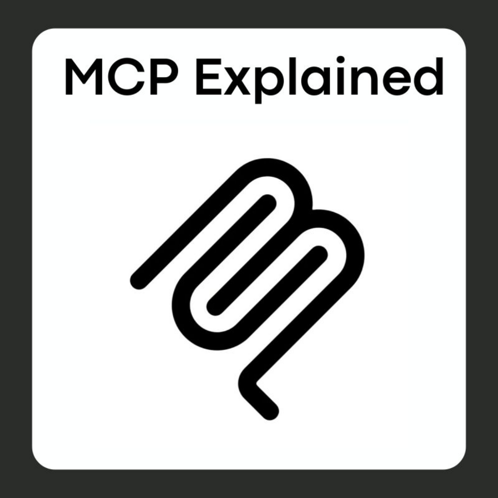

# Jav 🛠️ — full-control Android MCP runtime, no root

[](https://github.com/k4wai1)
[](https://ko-fi.com/kwai1)
[](LICENSE)

<p align="center"></p>

> **English first, español después.** Normative detail lives in `AGENTS.md`,
> `PROTOCOL.md`, `ARCHITECTURE.md`, `PLAN.md` and `docs/specs/`.

---

# 🇬🇧 ENGLISH

## What is Jav

**Jav is a full-control Android MCP runtime without root.** An on-device app
(**Jav**, `dev.k4wai1.jav`) exposes the screen via `AccessibilityService` and
privileged actions via **Shizuku** (started by the user) to a Go MCP server on
the PC (`jav`, `cmd/jav`, stdio).

Two clearly separated roles:

| | **Jav** (this repo) | **Director** (external, not part of Jav) |
|---|---|---|
| What | Go MCP server (`cmd/jav`) + Android app `dev.k4wai1.jav` | OpenCode / Claude / Cursor / operator |
| Does | exposes 38 atomic MCP tools, runs no loops and no internal planner | reads each screen, picks one atomic tool per step, verifies the effect |
| Tactical help | serves **`resolve_element`** (blind S1 Jev resolver) | decides goals, gates, and approves previews |

Jav never loops, never plans and never invents coordinates. The Director holds
the loop; Jav holds the device.

## Quickstart

```bash
# 1. Install the Go server (PC)
curl -fsSL https://raw.githubusercontent.com/k4wai1/jav/master/install.sh | sh
#    or: VERSION=v1.2.0 sh install.sh

# 2. Install the companion APK (Releases) and enable accessibility (once)
#    download jav-companion.apk from the latest GitHub Release, then:
adb install -r jav-companion.apk
#    Settings → Accessibility → enable Jav; copy the token shown in the app.

# 3. Start Shizuku (the USER starts it; the app only requests API_V23)

# 4. Forward + environment (PC)
adb forward tcp:38472 tcp:38472
cp .env.example .env   # edit JAV_TOKEN, OPENROUTER_API_KEY, models (chmod 600)

# 5. Point your Director (OpenCode/Claude/Cursor) at `jav` over stdio.
```

From source instead of Releases:

```bash
make build                 # dist/jav-linux-amd64
cd android-app && ./gradlew :app:assembleDebug
```

## Tools — 38, in 4 groups

Every tool returns `{ok, verified, evidence, hint}`. `verified: true` only with
real post-verification, never on "command sent". `tools/list` carries a compact
1–2 line description per tool; the full 7-section spec loads **on demand** as an
MCP Resource (`android://tool/<name>`, `android://tools/<group>`, index
`android://tools/catalog`). This keeps startup at **~1.6k tokens** instead of
~8.8k.

| Group | Tools |
|---|---|
| **state** | `device_status`, `get_foreground`, `list_packages`, `get_battery`, `get_memory`, `get_storage`, `get_cpu`, `get_device_info`, `get_audit` |
| **ui** | `read_screen`, `tap_node`, `tap_text`, `type_text`, `scroll`, `press_back`, `press_home`, `wait_for_text`, `open_app`, `close_app`, `screenshot` |
| **native** | `settings_get`, `settings_put`, `open_url`, `send_intent`, `get_clipboard_device`, `get_app_usage`, `list_contacts`, `add_contact`, `list_events`, `create_event`, `list_notifications`, `reply_notification`, `media_state`, `media_control`, `get_location`, `take_photo`, `adb_shell` |
| **resolve** | `resolve_element` (blind S1 resolver: `screen_goal_en` + `tau` → `idx`/`node_id`/`conf`/`snapshot_id` or the Sovereign fallback) |

Lanes: **N0** native, no new grants · **N1** native with user grants
(advertised in `hello.caps`) · **N2** Shizuku/`shell`, gated by the irreversible
denylist + interactive grant (1 cmd / 5 min / 30 min).

Sensitive tools (`settings_put`, `send_intent`, `add_contact`, `create_event`,
`reply_notification`, `media_control`, `take_photo`, `adb_shell`) never run on
first call: they return `{planned:true, preview, hint}` with `verified:false`
and only execute after `confirm:true`.

## What changed in v1.2.0

- **~80% fewer startup tokens.** 38 compact descriptions in `tools/list` +
  full 7-section specs on demand as Resources (`android://tool/<name>`);
  compacted `initialize` instructions (≤220 words). New `audit-mcp` check
  `token-budget-startup` certifies the budget.
- **Per-session cost summary, no per-call spam.** `pkg/cost` is silent by
  default (`JAV_DEBUG_COST=1` to trace) and accumulates
  `{jev_cost_usd, s2_cost_usd, total_cost_usd, calls}` delivered in
  `evidence.cost` of `device_status` / `resolve_element`.
- **Identity consolidated** as **`Jav`** / `dev.k4wai1.jav` (v1.0.0), with the
  self-signed TLS cert unified to `CN=jav.local`.
- **Phase 2b** (WSS tailnet + cert + token in Keystore + lockout) and
  **Phase 6** (audit ring 500 + Kill Switch + shell grant/denylist + N2) shipped.
- **New icon (1000×1000) and native UI polish**: launcher mipmaps, header logo,
  semantic `values`/`values-night` colors — zero new dependencies.
- **Docs cleanup**: historical specs moved to `docs/specs/archive/`; live
  contract in `docs/specs/`.

## Real runs with numbers (summary)

> Benchmarks own the numbers:
> [`docs/benchmarks/PERFORMANCE.md`](docs/benchmarks/PERFORMANCE.md) (per-tool
> latencies on real hardware) and
> [`docs/benchmarks/TASK_HISTORY.md`](docs/benchmarks/TASK_HISTORY.md) (closed
> tasks with wall/cost/forensics). This table only summarizes.

| Area | Figure (measured) |
|---|---|
| Perception `dump_ui` | ~2 ms/node (13n/40 ms, 66n/106 ms, 124n/264 ms; ~1 s worst @500) |
| tap (`ACTION_CLICK` first) | ~70 ms |
| S1 Jev | ~1.6 s |
| N0 native (Go e2e) | ~50–190 ms/tool |
| Cost ceiling | **<$0.003** per run |

Host: Debian, Go, MCP stdio; `dump_ui` is ~16× faster than `uiautomator dump`.

## Security

- **Scopes:** `read` (dump/screenshot) · `ui` (tap/type/scroll/back, grantless
  `open_app`) · `shell` (grant-gated, irreversible denylist + `confirm`) ·
  `admin` (token/audit/settings). Token mandatory on every bind (loopback
  included); lockout 5 fails/60 s → 5 min; 4 MiB frame; 50 req/s (shell 5/s).
- **Confirm:** messaging, paying, deleting, account/permission, photo, media
  stop and settings writes are critical: without `confirm:true` they are planned
  without executing (`planned:true` + `preview`).
- **Forensics:** `logs/run-<ts>.jsonl` per step (never raw sensitive text) plus
  fail-fast `run_signature`.
- **Kill switch:** Quick Settings tile + notification action (revoke tokens,
  stop the server). Push/pull only under `/sdcard/Download/jav-mcp/`.

## 👨‍💻 Developer

**[k4wai1](https://github.com/k4wai1)** — if Jav saved you time, consider
[buying a coffee](https://ko-fi.com/kwai1). Contributions via PRs welcome.

## 📜 License

This project is licensed under the **GNU General Public License v3.0** — see the
[LICENSE](LICENSE) file for details.

---

# 🇪🇸 ESPAÑOL

## Qué es Jav

**Jav es un runtime MCP de control integral de Android sin root.** Una app en el
dispositivo (**Jav**, `dev.k4wai1.jav`) expone la pantalla por
`AccessibilityService` y las acciones privilegiadas por **Shizuku** (lo arranca
el usuario) a un servidor MCP Go en el PC (`jav`, `cmd/jav`, stdio).

Dos roles separados:

| | **Jav** (este repo) | **Director** (externo, no es parte de Jav) |
|---|---|---|
| Qué es | servidor MCP Go (`cmd/jav`) + app Android `dev.k4wai1.jav` | OpenCode / Claude / Cursor / operador |
| Hace | expone 38 tools MCP atómicas; sin bucles ni planificador interno | lee cada pantalla, elige una tool atómica por paso, verifica el efecto |
| Ayuda táctica | sirve **`resolve_element`** (resolver ciego S1 Jev) | fija metas, compuertas y aprueba previews |

Jav no loopea, no planifica y nunca inventa coordenadas. El bucle lo lleva el
Director; el dispositivo lo lleva Jav.

## Quickstart

```bash
# 1. Instala el servidor Go (PC)
curl -fsSL https://raw.githubusercontent.com/k4wai1/jav/master/install.sh | sh
#    o: VERSION=v1.2.0 sh install.sh

# 2. Instala la APK companion (Releases) y activa accesibilidad (una vez)
#    descarga jav-companion.apk del último Release y:
adb install -r jav-companion.apk
#    Ajustes → Accesibilidad → activa Jav; copia el token que muestra la app.

# 3. Shizuku lo arranca el USUARIO (la app solo pide el permiso runtime API_V23)

# 4. Forward + entorno (PC)
adb forward tcp:38472 tcp:38472
cp .env.example .env   # edita JAV_TOKEN, OPENROUTER_API_KEY, modelos (chmod 600)

# 5. Apunta tu Director (OpenCode/Claude/Cursor) a `jav` por stdio.
```

## Herramientas — 38 en 4 grupos

Toda tool devuelve `{ok, verified, evidence, hint}`. `tools/list` lleva una
descripción compacta de 1–2 líneas; la ficha completa de 7 secciones se carga
**bajo demanda** como Resource MCP (`android://tool/<name>`,
`android://tools/<group>`, índice `android://tools/catalog`).

| Grupo | Tools |
|---|---|
| **state** | `device_status`, `get_foreground`, `list_packages`, `get_battery`, `get_memory`, `get_storage`, `get_cpu`, `get_device_info`, `get_audit` |
| **ui** | `read_screen`, `tap_node`, `tap_text`, `type_text`, `scroll`, `press_back`, `press_home`, `wait_for_text`, `open_app`, `close_app`, `screenshot` |
| **native** | `settings_get`, `settings_put`, `open_url`, `send_intent`, `get_clipboard_device`, `get_app_usage`, `list_contacts`, `add_contact`, `list_events`, `create_event`, `list_notifications`, `reply_notification`, `media_state`, `media_control`, `get_location`, `take_photo`, `adb_shell` |
| **resolve** | `resolve_element` |

Carriles: **N0** nativo sin permisos nuevos · **N1** nativo con grants del
usuario · **N2** Shizuku/`shell`, con denylist de irreversibles + grant
interactivo (1 cmd / 5 min / 30 min).

## Qué cambió en v1.2.0

- **~80% menos tokens de arranque**: descripciones compactas en `tools/list` +
  fichas completas bajo demanda como Resources; instructions ≤220 palabras.
- **Resumen de costo por sesión sin spam**: `pkg/cost` silencioso por defecto
  (`JAV_DEBUG_COST=1` para trazar) y `evidence.cost` con
  `{jev_cost_usd, s2_cost_usd, total_cost_usd, calls}` en `device_status` /
  `resolve_element`.
- **Identidad consolidada** (`Jav` / `dev.k4wai1.jav`) y cert TLS unificado a
  `CN=jav.local`.
- **Fase 2b** (WSS tailnet + cert + token en Keystore + lockout) y **Fase 6**
  (audit ring 500 + Kill Switch + shell grant/denylist + N2).
- **Icono nuevo (1000×1000) y pulido visual nativo** sin dependencias nuevas.
- **Poda documental**: specs históricos a `docs/specs/archive/`.

## 👨‍💻 Desarrollador

**[k4wai1](https://github.com/k4wai1)** — si Jav te ahorró tiempo, considera
[invitar un café](https://ko-fi.com/kwai1). PRs bienvenidos.

## 📜 Licencia

Este proyecto está bajo la **GNU General Public License v3.0** — ver el archivo
[LICENSE](LICENSE) para el texto completo.
